<div align="center">




### Final-Year CSE @ VIT Chennai | Algorithmic Trading Builder | Bloomberg-Style Terminal Developer | Open to Fintech & Product Roles


[](https://github.com/Vinayakkilledarcode)
<!-- Uncomment and fill in when ready:
[](https://www.linkedin.com/in/YOUR_LINKEDIN/)
[](https://leetcode.com/u/YOUR_LEETCODE/)

**Email:** `YOUR_EMAIL`  |  **Resume:** [View Resume](YOUR_RESUME_LINK)
-->

**Currently Working On**

 


</div>

* * *

## About Me

Final-year **Computer Science Engineering** student at **VIT Chennai (2026 batch)** focused on **algorithmic trading**, **quantitative finance**, and building **financial tools**. Experienced in designing **signal engines**, **risk layers**, **real-time trading terminals**, and **explainable ML pipelines**. Interested in **market microstructure**, **systematic strategies**, and **fintech product engineering**. Seeking **full-time roles at fintech and product companies**.

### Skills Distribution

```
Full-Stack Development  ████████████░░  85%
Python / Backend        ███████████░░░  80%
Algo Trading / Quant    ██████████░░░░  75%
Machine Learning        █████████░░░░░  70%
Android (Kotlin)        ███████░░░░░░░  55%
```

### Achievements

<div align="center">

[](https://github.com/ryo-ma/github-profile-trophy)

</div>

* * *

## Projects

### Trading & Quant Systems

| Project | Description | Tech Stack | Links |
|:---:|:---:|:---:|:---:|
| **Thrice Nomisma** | Bloomberg-style trading terminal with a ~100-indicator engine, 11 strategy modules, regime detection, signal consensus and a 3D indicator waveform | `Electron` `React` `TypeScript` `FastAPI` `Three.js` | [](https://github.com/Vinayakkilledarcode/thrice-nomisma) |
| **AI Binary Bot** | ML-driven binary trading bot with market-movement prediction, automated execution and risk management | `Python` `scikit-learn` `TensorFlow` | [](https://github.com/Vinayakkilledarcode/ai-binary-bot) |
| **Deriv Trading Bot** | Automated trading bot for the Deriv platform | `JavaScript` `Node.js` | [](https://github.com/Vinayakkilledarcode/deriv-trading-bot) |

### Explainable AI & NLP

| Project | Description | Tech Stack | Links |
|:---:|:---:|:---:|:---:|
| **NutriWise AI** | Explainable nutrition-risk assessment with SHAP-driven personalised recommendations | `Flask` `scikit-learn` `SHAP` | [](https://github.com/Vinayakkilledarcode/nutriwise-ai) |
| **Insight-Ink** | NLP news summarisation pipeline | `Python` `spaCy` `Hugging Face` | [](https://github.com/Vinayakkilledarcode/Insight-Ink) |

### Security & Systems

| Project | Description | Tech Stack | Links |
|:---:|:---:|:---:|:---:|
| **SecureAppVault** | Android security app: AES-256-GCM, TLS pinning, MITM detection | `Kotlin` `Android` | [](https://github.com/Vinayakkilledarcode/secureappvult) |
| **Last-Mile-Delivery** | Last-mile delivery management system | `JavaScript` | [](https://github.com/Vinayakkilledarcode/Last-Mile-Delivery) |
| **Ration Distribution System** | Ration distribution management platform | `JavaScript` | [](https://github.com/Vinayakkilledarcode/ration-distribution-system) |

* * *

## Education

| Institution | Qualification | Period | Highlights |
|:---|:---|:---:|:---|
| **Vellore Institute of Technology, Chennai** | B.Tech in Computer Science Engineering |  | Focus: Algorithmic Trading, Quant Finance, Full-Stack Systems |

* * *

## Tech Stack

### Skills Proficiency

> **Expert**  ·  **Proficient**  ·  **Familiar**

| Domain | Tools |
|:---:|:---|
| **Languages** | **Expert:** Python, JavaScript  ·  **Proficient:** TypeScript, Java, Kotlin  ·  **Familiar:** SQL |
| **Backend** | **Expert:** FastAPI, Flask  ·  **Proficient:** Node.js |
| **Frontend** | **Expert:** React  ·  **Proficient:** TypeScript, Electron, Three.js |
| **AI / ML** | **Proficient:** scikit-learn, TensorFlow, SHAP, Hugging Face  ·  **Familiar:** Keras, spaCy |
| **Quant / Trading** | **Proficient:** Technical indicators, backtesting, risk management, FinBERT sentiment |
| **Dev Tools** | **Expert:** Git, GitHub, VS Code |

### Programming Languages


### Web Technologies


### Backend Frameworks


### Machine Learning & Data


### Mobile


### Dev Tools


* * *

<div align="center">


<br/><br/>

<h3>Profile Summary Cards</h3>

<table>
<tr>
<td colspan="2" align="center"></td>
</tr>
<tr>
<td align="center"></td>
<td align="center"></td>
</tr>
<tr>
<td align="center"></td>
<td align="center"></td>
</tr>
</table>

<br/>


</div>
