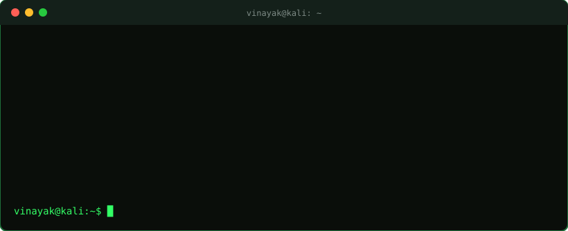
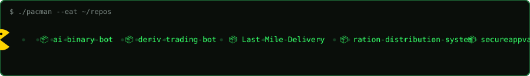

<div align="center">





</div>

## `$ ./pacman --eat ~/repos`
<div align="center"></div>

## `$ ./snake --eat contributions`
<div align="center">
<picture>
  <source media="(prefers-color-scheme: dark)" srcset="https://raw.githubusercontent.com/Vinayakkilledarcode/Vinayakkilledarcode/output/github-snake-dark.svg"/>
  
</picture>
</div>

## `$ cat stack.txt`


## `$ git stats`


```bash
vinayak@kali:~$ echo "open to fintech & product roles"  # placements 2026
```
